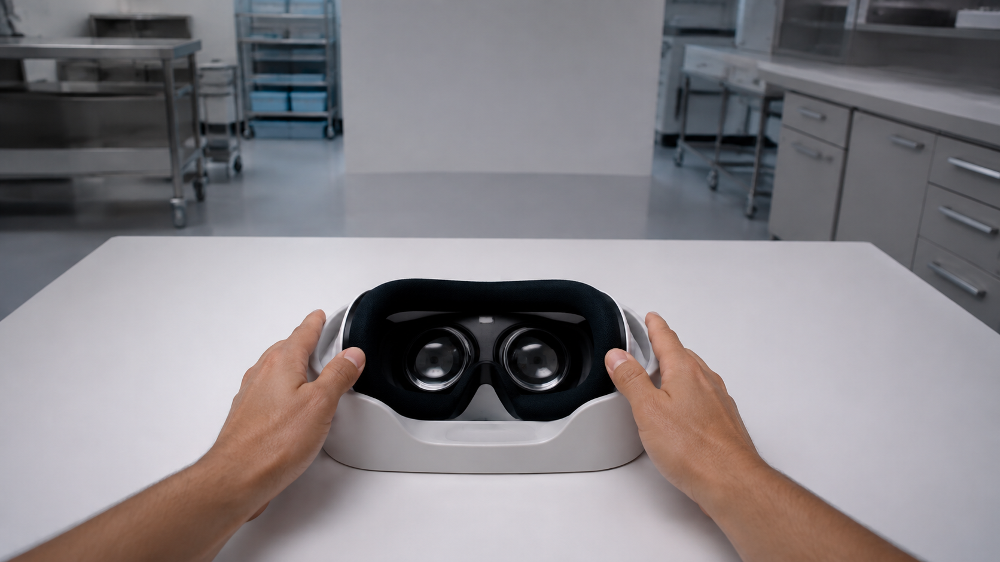
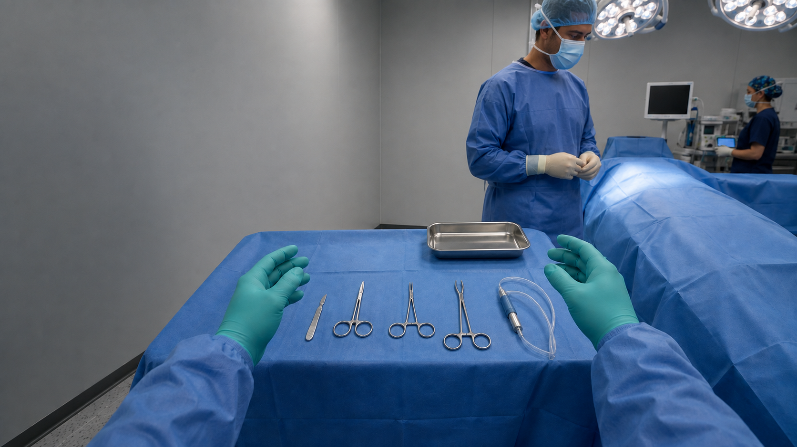
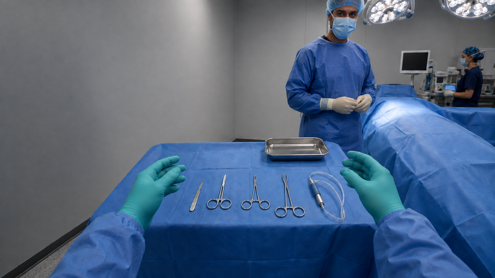
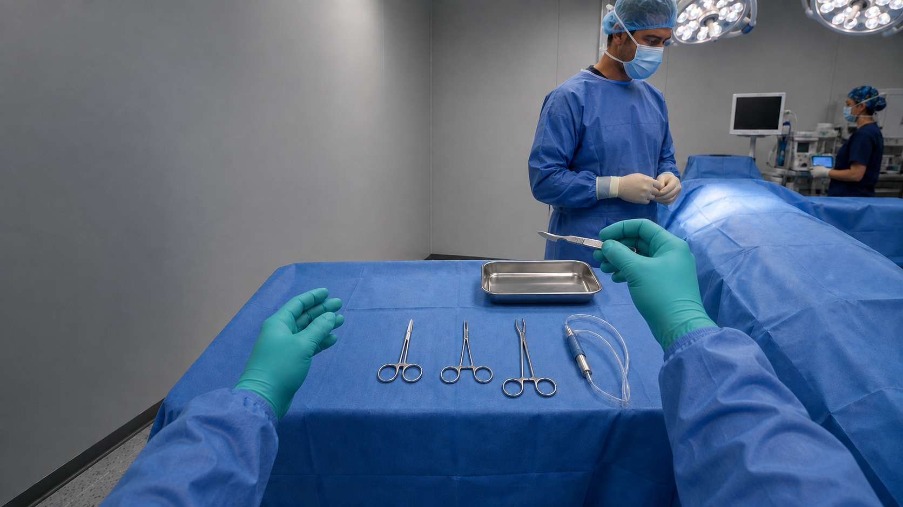
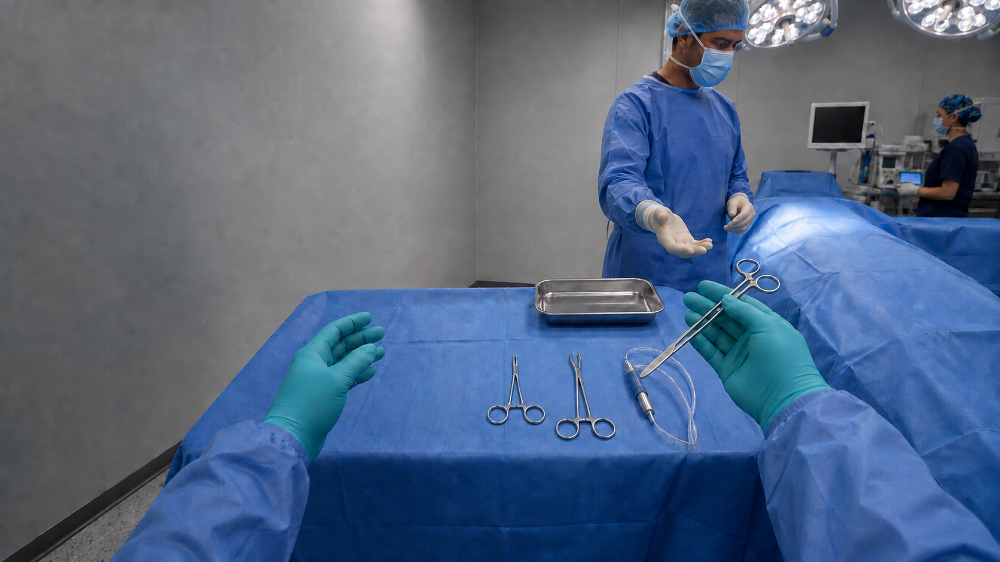
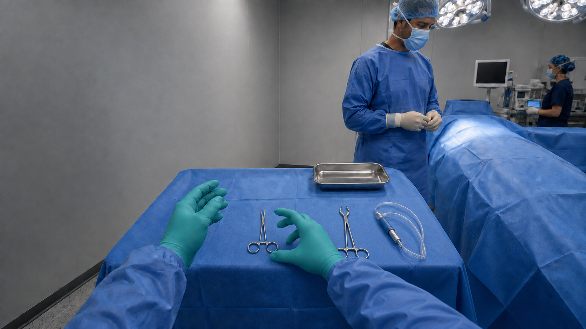
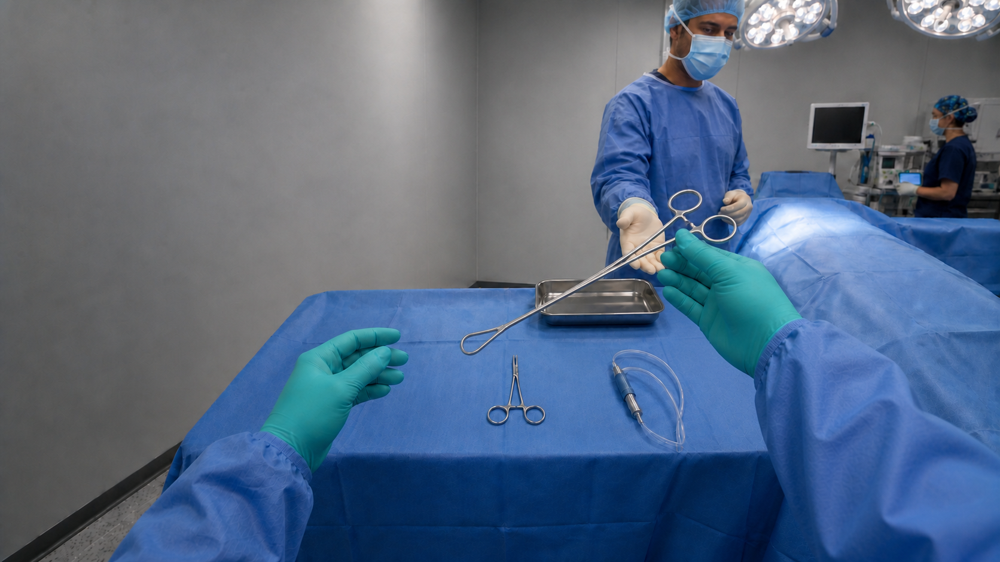
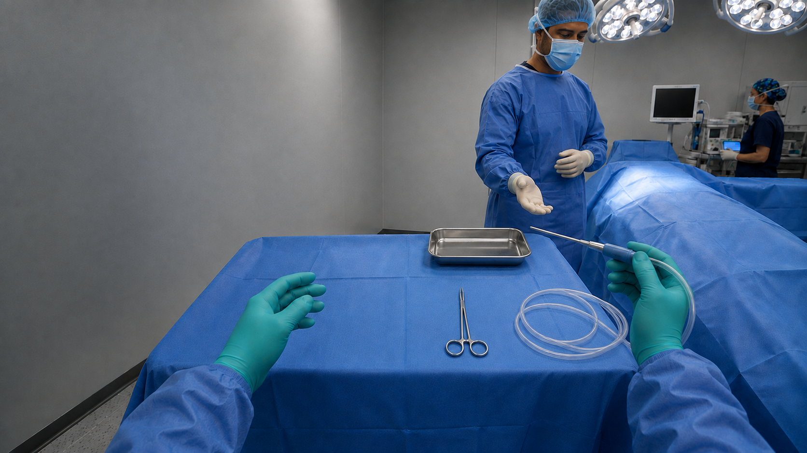
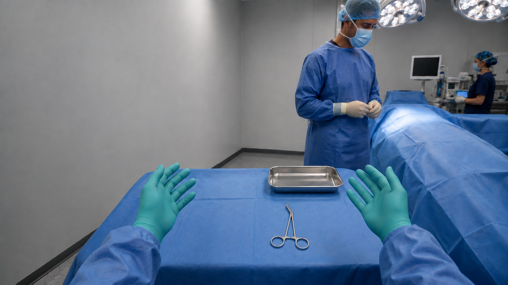

# Scene images and English video prompts

Upload each PNG as the starting image and use its matching English TXT prompt. Scene 01A and 01B are joined in editing.

## Scene 01A

[Starting image](scene-01a-lab.png) · [English motion prompt](video-prompts/scene-01a.txt)

## Scene 01B

[Starting image](scene-01b-or-entry.png) · [English motion prompt](video-prompts/scene-01b.txt)

## Scene 02

[Starting image](scene-02-readiness.png) · [English motion prompt](video-prompts/scene-02.txt)

## Scene 03

[Starting image](scene-03-scalpel.png) · [English motion prompt](video-prompts/scene-03.txt)

## Scene 04

[Starting image](scene-04-scissors.png) · [English motion prompt](video-prompts/scene-04.txt)

## Scene 05

[Starting image](scene-05-wrong-selection.png) · [English motion prompt](video-prompts/scene-05.txt)

## Scene 06

[Starting image](scene-06-babcock.png) · [English motion prompt](video-prompts/scene-06.txt)

## Scene 07

[Starting image](scene-07-suction.png) · [English motion prompt](video-prompts/scene-07.txt)

## Scene 08

[Starting image](scene-08-closing.png) · [English motion prompt](video-prompts/scene-08.txt)

